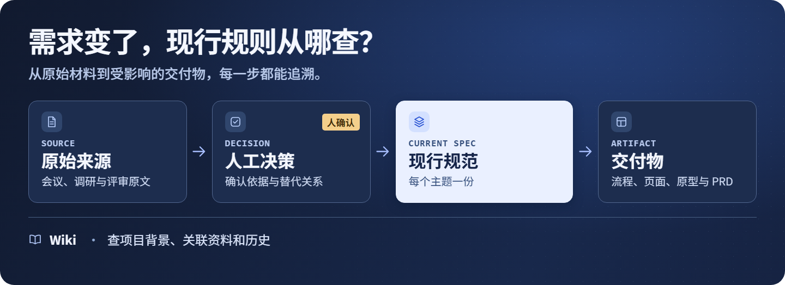

# 产品治理工作流

**人用 Obsidian 看项目，AI 打开同一个本地工作区跟进需求。**

会议纪要、人工决策、现行规范和待同步事项用本地 Markdown 管理。新开会话或换一款能读写本地文件的 AI 时，打开同一个目录，让它从 `AGENTS.md` 和已有记录接着做。

**[下载 ZIP，解压使用](https://github.com/luoss33/product-governance-workflow/releases/latest/download/product-governance-workflow.zip)** · [搭配 Obsidian 上手](#在本地试用) · [看确认前后对照](#活动报名取消示例)



## 在本地试用

1. 下载并解压 ZIP，找到包含 `AGENTS.md` 的那一层文件夹。
2. 在 Obsidian 把这个文件夹打开为库，从 [知识库入口](知识库入口.md) 查看待确认事项、现行规范和资产同步状态。[Obsidian 打开已有文件夹](https://obsidian.md/help/Files%2Band%2Bfolders/Manage%2Bvaults#create-vault-from-an-existing-folder)
3. 在能读写本地文件的 AI 工具里打开同一个文件夹，把下面的试用指令发过去。要处理自己的纪要，可以将它放在 `01、来源`。

```text
先读工作区根目录的 AGENTS.md。根据 examples/活动报名取消/会议纪要.md，
给出本次变化、一个推荐、完整的待确认规则和受影响的交付物。我先看方案。
```

<details>
<summary><strong>查看 ZIP 解压后的主要目录</strong></summary>

```text
product-governance-workflow/
├── AGENTS.md              # AI 工作入口
├── 00、工作台/            # 规范索引、资产登记和模板
├── 01、来源/              # 会议纪要、调研和评审材料
├── 02、决策/              # 人工确认记录
├── 03、当前规范/          # 各主题的现行规则
├── 04、资产/              # 流程、页面等交付物
├── 05、Wiki/              # 项目背景和阅读导航
├── 99、历史/              # 旧版档案
├── .agents/skills/        # 产品变更和业务事实治理指引
└── examples/活动报名取消/  # 两轮示例和产物
```

</details>

包里有[产品变更工作流](.agents/skills/product-change-workflow/SKILL.md)、[业务事实治理](.agents/skills/business-spec-manager/SKILL.md)两份 AI 指引，以及空白登记表、流程和页面模板。

用普通 Markdown 编辑器也能查看工作区。Git 可在本机按需启用，用文件差异和提交历史核对改动。[完整上手指南](docs/quickstart.md)

## 从自增长知识库到产品治理

我原本想让 AI 帮我管产品项目。用久了，最花时间的是防止 AI 把项目改错。

最早我借鉴卡帕西的 LLM Wiki，让 AI 持续整理纪要和评审资料、更新主题页、连上相关来源。回查早期讨论顺手了，换个会话也能接着做。[卡帕西的 LLM Wiki 原文](https://gist.github.com/karpathy/442a6bf555914893e9891c11519de94f)

需求反复调整之后，新规则已经定了，AI 下一轮还可能引用旧原型。规范改了，页面或 PRD 也可能还沿用旧写法。我需要在每次变更后知道哪一版生效、哪次确认替换了旧规则，以及哪份交付物还待同步。

## 一次需求变更怎么走

[原始来源](<01、来源/README.md>) → [人工决策](<02、决策/README.md>) → [现行规范](<03、当前规范/README.md>) → [交付物](<04、资产/README.md>)

1. **先审方案。** AI 对照现行规则，给出一个推荐、完整的待确认规则和受影响的交付物。
2. **人确认规则。** 决策记录保留确认原话、依据和替代关系。每个主题用一份规范薄账本记录有效规则。
3. **按范围同步。** AI 按本批阶段和授权范围更新主交付物，再核对场景、记录同步状态。正式交付按具体资产、版本和范围验收。

[Wiki](<05、Wiki/README.md>) 用来查背景和历史。[治理协议](<00、工作台/治理协议.md>) 说明怎么确认规则、同步普通资产和处理锁定文件。

Obsidian 的反向链接能列出已链接到一条规范的笔记。判断这一轮要改哪些交付物时，结合规则差异和资产登记逐项核对。[Obsidian 反向链接说明](https://obsidian.md/help/plugins/backlinks)

## 需求频繁变更时，按阶段维护

日常确认的业务变化先落到现行规范薄账本，再更新当期主交付物。薄账本保留对象边界、角色权限、状态和关键规则，界面排版与话术在评审载体中维护。

| 正在做什么 | 维护重点 |
| --- | --- |
| 方案对齐 | 薄账本＋原型或主流程图，页面方案也可作为评审载体。 |
| PRD 定稿 | 薄账本＋PRD，Word 细表与排版在送审前集中整理。 |
| PRD 稳定后 | 依据已确认的版本更新测试用例。 |

早期字段表、对象草图和停用稿按约定转入过渡区，标为「暂不维护」，保留文件和上次同步依据。重新启用时，再核对期间的规则变化。[阶段维护约定](<00、工作台/治理协议.md#按阶段维护主交付物>)

## 活动报名取消示例

示例处在方案对齐阶段，以薄账本和页面方案作为主交付。第一次确认活动开始前可取消，复评把截止点提前到距活动开始至少 24 小时。旧决策仍可查，现行规范和页面方案按新的时间边界同步，页面方案待评审。[查看两轮输出](<examples/活动报名取消/演练产物.md>) · [跟做案例](<examples/活动报名取消/README.md>)

<details>
<summary><strong>展开查看确认前后的文件与状态</strong></summary>

| 阶段 | 工作区里看到什么 |
| --- | --- |
| 第一轮确认前 | AI 对比「开始前」和「至少提前一天」两个候选截止点，给出推荐和要审阅的完整规则。 |
| 第一轮确认后 | 决策保存确认依据，现行规范记录「活动开始前可取消」，页面方案按这条规则更新并进入待评审。 |
| 第二轮改截止点 | 原规则标为已替代，现行规范采用「距开始至少 24 小时」。页面方案先标待同步，按新边界更新并核对后标为已同步。 |

[查看两轮文件摘录和场景结果](<examples/活动报名取消/演练产物.md>)

</details>

## 常见问题

**和直接给 AI 一段提示词有什么区别？**

提示词告诉 AI 怎么开始。换个会话时，AI 可以从 `当前状态.md` 找到当前规则，从 `当前资产.md` 查上次同步到哪条决策。

**每次改动都要改现行规范吗？**

文案、样式等纯表达调整直接处理目标文件。已确认的业务变化写入该主题薄账本，随后同步当期主交付物。Word PRD 在送审前集中整理，过渡文件按约定暂不维护。

**下载包里可以直接用什么？**

两份 AI 指引、空白登记表、Markdown 流程和页面方案模板，以及可复跑的虚构案例。原型和 PRD 可以作为下游交付物，按确认范围更新。

[MIT 许可证](LICENSE)
