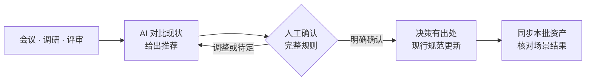

# 产品治理工作流

开完会，把真正变化的产品规则整理出来，等人确认后，再更新规范和交付物。这是一套**本地优先的 AI 协作模板**，适合需要持续维护流程、页面和 PRD 的产品经理与小团队。

[下载本地工作区 ZIP](https://github.com/luoss33/product-governance-workflow/releases/latest/download/product-governance-workflow.zip) · [快速上手](docs/quickstart.md) · [看一个完整案例](<examples/活动报名取消/README.md>)


## 第一次用

**下载并解压 → 让 AI 打开这个文件夹 → 交给它第一份会议纪要。** 层级目录、空白登记表和工作指引已经放好。用 Obsidian 时，可把同一个文件夹打开为库。Git 可以按需在本地启用。

把下面的话发给能读取这个目录的 AI，即可拿虚构案例试一次。

```text
先读这个工作区根目录的 AGENTS.md。请根据
examples/活动报名取消/会议纪要.md
给出本次变化、一个推荐方案和完整的待确认规则。我先看方案。
```

## 从讨论到交付



| 产品经理看什么 | AI 协助维护什么 |
| --- | --- |
| 哪些行为真要变，推荐怎么改，还有什么需要拍板 | 原话和出处、决策记录、每个主题的一份现行规范 |
| 哪些流程、页面或 PRD 受影响，更新后是否符合预期 | 影响范围、资产同步状态、实际落点和验证结果 |

普通工作资产按获授权的范围同步。锁定资产需要具体授权，正式交付按具体版本验收。详见[治理协议](<00、工作台/治理协议.md>)。


## 试做活动报名取消

会议想让报名人自行取消，具体截止时间还没定。案例展示如何给出一个推荐，明确截止边界，记录人的确认，再把同一条规则写进现行规范和报名页面方案。

[打开纪要、练习和结果](<examples/活动报名取消/README.md>)

## 工作区里有什么

| 位置 | 使用方式 |
| --- | --- |
| [知识库入口](知识库入口.md)与 [00、工作台](<00、工作台/治理协议.md>) | 找主题、待确认问题、资产和模板 |
| [01、来源](<01、来源/README.md>) → [02、决策](<02、决策/README.md>) → [03、当前规范](<03、当前规范/README.md>) | 从原始材料追到人工确认，再查当前执行口径 |
| [04、资产](<04、资产/README.md>) | 按确认后的规则维护流程、页面、原型和 PRD |
| [05、Wiki](<05、Wiki/README.md>)、[99、历史](<99、历史/README.md>) | 查阅和追溯旧版 |

准备维护一套真实项目时，打开[快速上手](docs/quickstart.md)。想检查登记结构和引用时，可以运行[本地检查](.governance/README.md)。

[MIT 许可证](LICENSE) · 文档配图为本项目生成。
