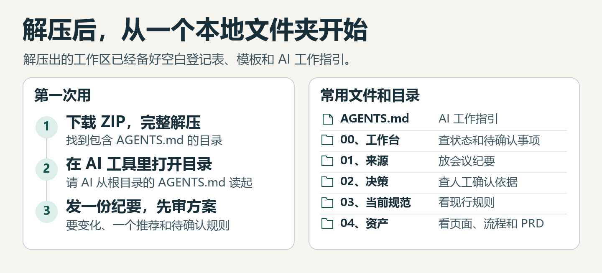
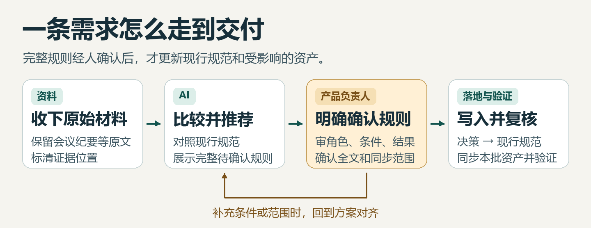
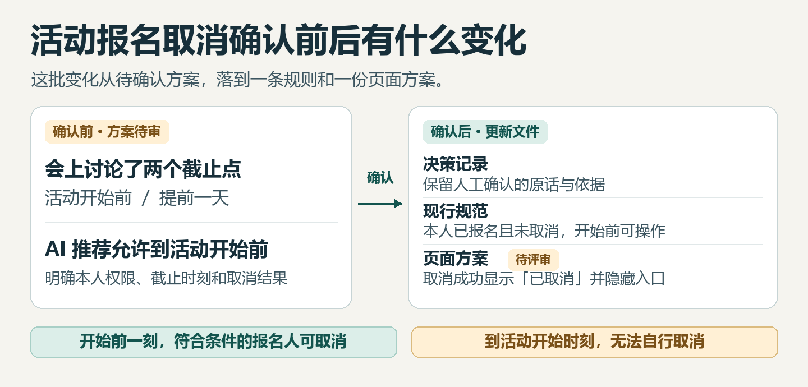

# 产品治理工作流

一套给产品经理和小团队用的**本地 AI 工作流**。需求反复变更时，用它查清现在执行哪条规则、谁确认了这次变化，以及哪些页面、流程和 PRD 需要更新。

[下载本地工作区 ZIP](https://github.com/luoss33/product-governance-workflow/releases/latest/download/product-governance-workflow.zip) · [快速上手](docs/quickstart.md) · [跟做完整示例](<examples/活动报名取消/README.md>)

## 从自增长知识库到产品治理

我最早照着卡帕西的 LLM Wiki 搭了一个能随资料增长的知识库。每次开完会，把纪要和评审资料交给 AI，它会提炼要点、更新主题页，把相关资料连起来。刚开始用得很顺，换个会话也能从已有资料接着做。[卡帕西的 LLM Wiki 原文](https://gist.github.com/karpathy/442a6bf555914893e9891c11519de94f)

需求来回改了几轮后，我开始花更多时间核对 AI 改了什么。一处改了，原型和 PRD 可能还留着旧口径。下一轮 AI 读到旧原型，又可能把页面上的做法当成已经确认的业务规则。以往的讨论都能查到，到了要交付时，我还得把几份文件再对一遍，才能弄清**现在以哪一版为准、这次替换了什么、还有哪些交付物没跟上**。

于是我围绕**一批需求变更**重新设计了工作流。AI 先拿新材料对照现行规则，给出一个推荐，说明会影响哪些交付物。产品负责人确认完整规则后，AI 把原话和确认依据记入决策，更新该主题唯一的现行规范，再按确认范围同步交付物，并核对对应场景的结果。要了解项目背景和来龙去脉，可以从 Wiki 和原始资料往回查。

## 三步开始



下载并解压工作区，在能读取本地文件的 AI 工具中打开包含 `AGENTS.md` 的文件夹。你也可以用 Obsidian 打开它。将第一份会议纪要放在 `01、来源`，让 AI 先读工作区里的指引，再给出方案。

试用时，可将这段话发给 AI：

```text
先读当前工作区根目录 AGENTS.md。请根据
examples/活动报名取消/会议纪要.md
说明本次变化，给出一个推荐方案、完整的待确认规则和受影响资产。我先看方案。
```

## 先对齐，再更新



AI 负责梳理变化、提出主推荐并说明影响范围。你检查完整规则和本批同步范围。需要调整时，补充条件后重新对齐。明确确认之后，AI 才把规则写入决策和现行规范，再按授权范围更新资产。

普通工作资产按已声明范围同步。锁定资产需要对具体文件和变更的授权。页面或流程完成后可以进入评审，正式交付另行绑定具体资产、版本和范围。[查看治理约定](<00、工作台/治理协议.md>)。

## 试做活动报名取消



示例纪要没有确定报名人应提前一天取消，还是可以在活动开始前取消。你可以先审 AI 的推荐，再确认完整规则，并查看决策、现行规范和待评审的页面方案。[打开会议纪要、练习和结果](<examples/活动报名取消/README.md>)。

## 工作区里有什么

| 位置 | 用途 |
| --- | --- |
| [知识库入口](知识库入口.md)、[治理协议](<00、工作台/治理协议.md>) | 找当前状态、待确认事项、资产和模板 |
| [01、来源](<01、来源/README.md>) → [02、决策](<02、决策/README.md>) → [03、当前规范](<03、当前规范/README.md>) | 从原始材料追到确认依据和当前规则 |
| [04、资产](<04、资产/README.md>) | 维护流程、页面、原型和 PRD |
| [05、Wiki](<05、Wiki/README.md>)、[99、历史](<99、历史/README.md>) | 阅读工作区资料和历史版本 |

检查目录、登记表和文件引用可运行[本地结构检查](.governance/README.md)。它检查工作区结构，不替代业务场景验证或正式交付验收。

[MIT 许可证](LICENSE)
