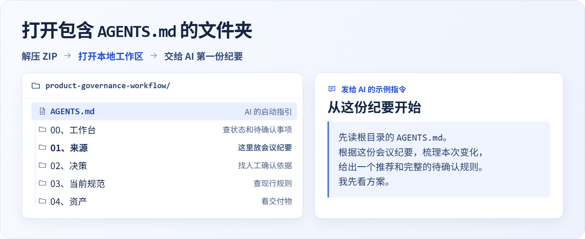

# 快速上手

## 1. 下载并打开

从[发布页](https://github.com/luoss33/product-governance-workflow/releases/latest)下载 `product-governance-workflow.zip` 并完整解压。把包含 `AGENTS.md` 和 `00、工作台` 的文件夹交给能读取、编辑本地文件的 AI 工具。



也可以用 Obsidian 把这个目录打开为库，再从普通编辑器查看和修改 Markdown 文件。目录、空白登记表和模板都已准备好。

## 2. 先让 AI 提方案

把会议纪要保存在 `01、来源`，按它的实际文件位置替换下面的路径。

```text
先读当前工作区根目录 AGENTS.md。请根据
01、来源/我的会议纪要.md
说明相对于现行规范有哪些变化，给出一个主推荐、完整的待确认规则和本批资产影响。我先审方案。
```

检查方案里的业务结果、适用角色与条件、边界场景和同步范围。纪要中的候选项仍待确认。补充重要条件后，让 AI 重新展示完整规则。

## 3. 确认后再更新

确认回复要明确指向刚展示的完整规则或编号批次。

```text
确认本轮展示的「确认批次 1」完整规则，按已声明的范围更新
现行规范和普通工作资产。请检查对应场景并告诉我结果。
```

锁定文件需指定具体资产和变更。正式交付时，指明资产、版本和范围。确认后，查看决策、当前状态、资产登记和对应文件。

## 4. 可选的本地检查

Node.js 24 可运行只读结构检查：

```text
node .governance/check.mjs
```

检查覆盖目录、登记表和文件引用。业务场景和正式交付按[治理协议](<../00、工作台/治理协议.md>)核对。想保留版本记录时，可在本机启用 Git。
