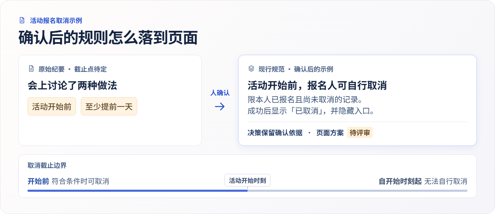

# 活动报名取消示例

这是一个虚构的社区读书会案例。示例工作区从空白状态开始。打开[会议纪要](会议纪要.md)，让 AI 根据原始材料先给方案。

```text
先读当前工作区根目录 AGENTS.md，把
examples/活动报名取消/会议纪要.md
当作本次需求的原始输入。计划把
04、资产/活动报名-页面方案.md
作为普通工作资产。给我本次变化、一个推荐、完整的待确认规则和同步范围。我先审方案。
```

## 纪要留下了哪些待定项

目前报名人想取消时要联系组织者。会议希望让报名人可以在报名详情自行处理。会议讨论了活动开始前和至少提前一天两个截止点，尚未选定其一。会议还提出显示「已取消」状态，并将名额释放和候补通知留到后续讨论。

一种推荐是允许报名人在活动开始时刻前自行取消。现场负责人在活动开始时核对名单，已取消记录如何出现在名单中留待后续确认。

下面这段是可交给产品负责人确认的完整候选规则，确认前不要据此更新当前规范或页面方案。

> 已报名且报名记录属于本人的参与者，可以在活动开始时刻之前，从报名详情自行取消本人的报名。取消成功后，报名状态显示为「已取消」，取消入口隐藏。活动开始时刻起，报名人无法自行取消。名额释放和候补通知留待后续决定。

边界场景需要包含开始前、开始时刻、已取消和他人的报名记录。若 AI 的推荐或规则文本增添了条件，先对齐调整后的完整规则。

## 明确确认后再同步

确认范围限于上面这批完整规则和已声明的普通工作资产 `04、资产/活动报名-页面方案.md`。若同意本轮展示的规则，可发：

```text
确认你刚展示的这一批完整规则。请原文留存这份虚构纪要，
写入决策与现行规范，并按范围更新活动报名的页面方案，交付状态待评审。
```

之后从[知识库入口](../../知识库入口.md)查结果：



| 位置 | 核对内容 |
| --- | --- |
| `01、来源` | 原始纪要副本和来源登记 |
| `02、决策` | 确认回复、规则全文和未覆盖事项 |
| `03、当前规范` | 活动报名主题唯一的现行规范 |
| `04、资产` | 页面里的角色、入口、时间边界和操作结果，状态为待评审 |

准备放入真实资料时，从 ZIP 再解压一份工作区即可。
